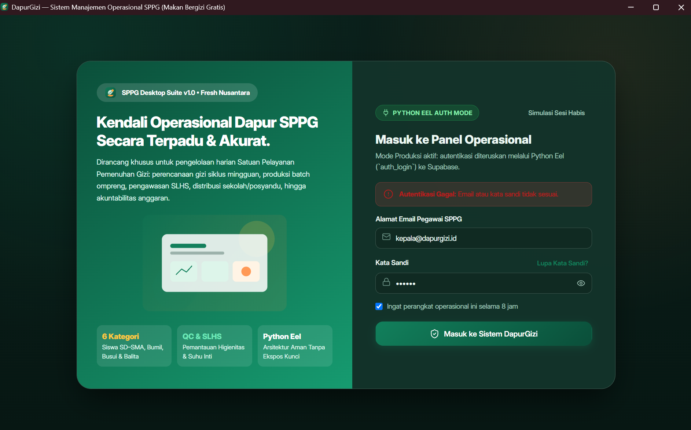
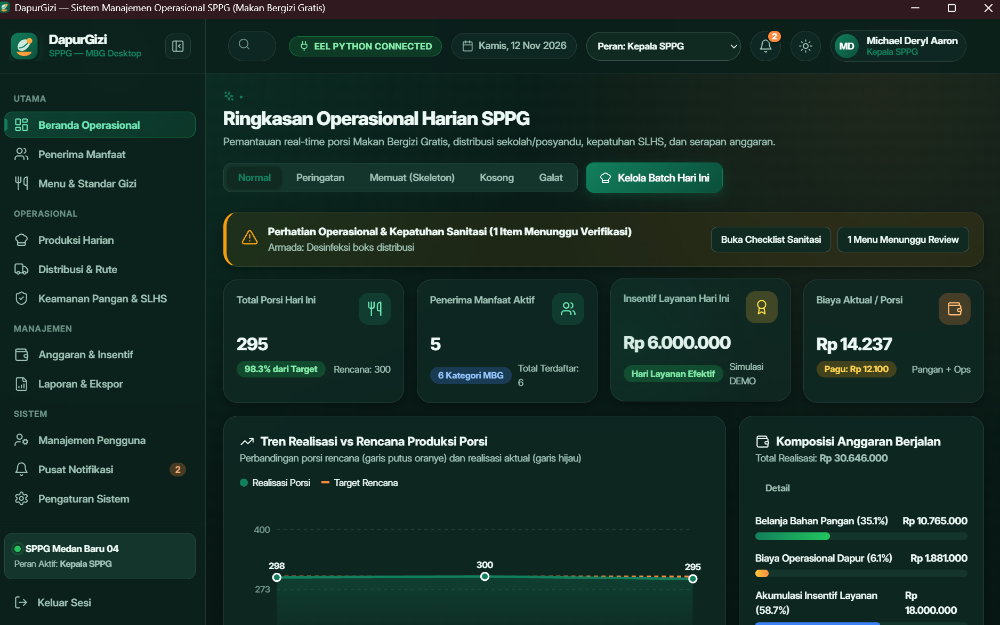
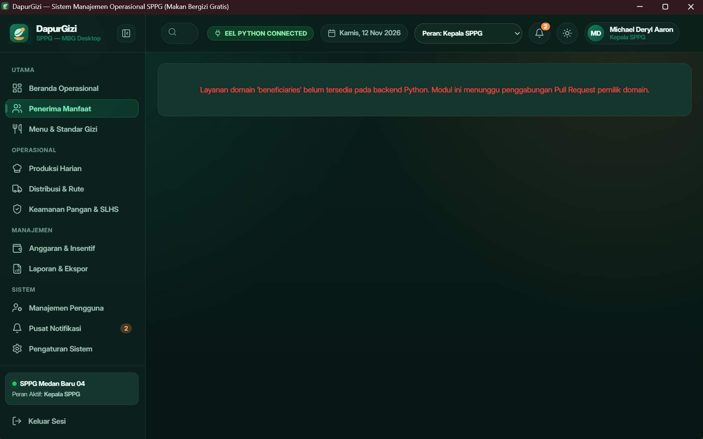
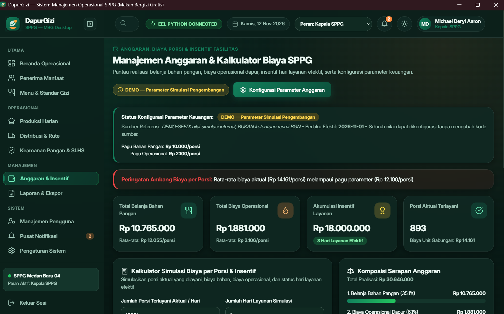
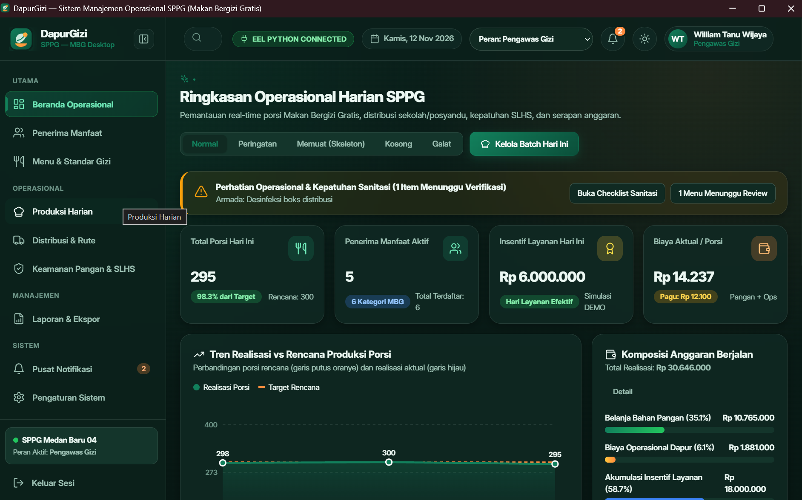
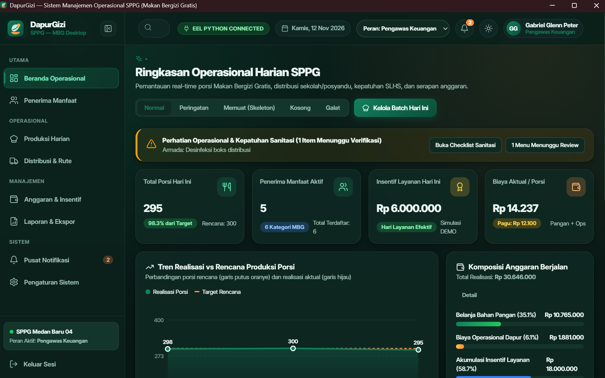
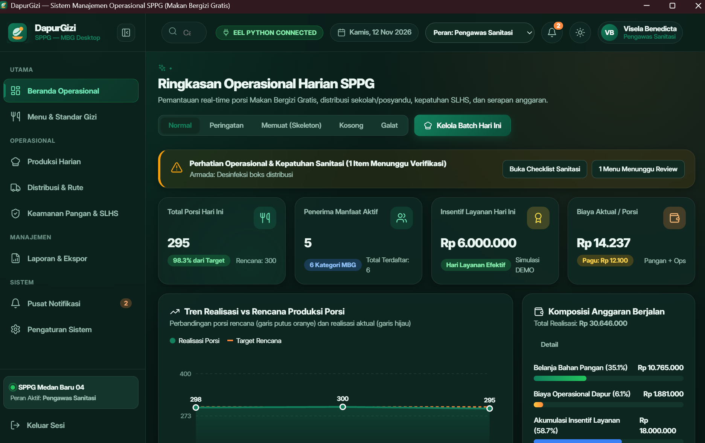
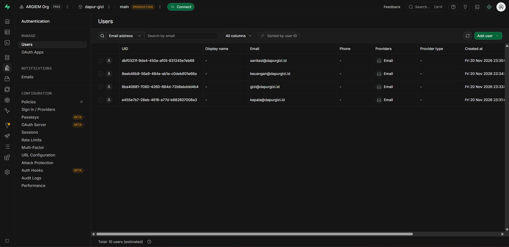
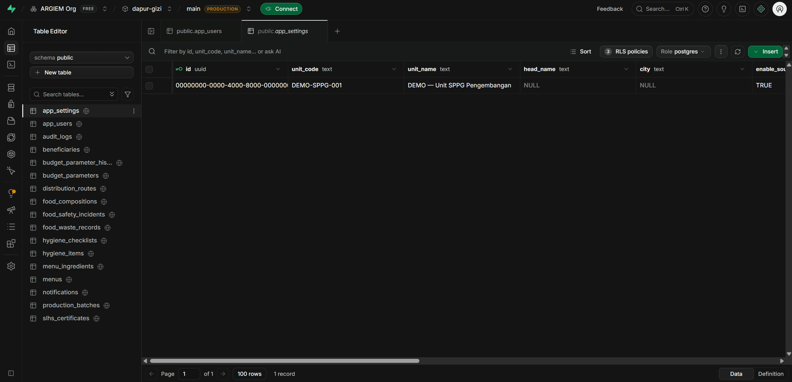

# Laporan Backend Gabriel — DapurGizi

Tanggal: 20 November 2026
Branch kerja: `feature/gabriel-backend-platform` (belum dibuat/di-commit — lihat §13)
HEAD saat pengerjaan: `2b43b8b` (working tree belum di-commit)

---

## 1. Ringkasan

Backend DapurGizi dibangun dari fondasi minimal menjadi lapisan platform yang
lengkap: konfigurasi, container dependency injection, autentikasi Supabase,
sesi server-side, repository adapter, RBAC, seluruh handler Eel sesuai
`INTEGRATION.md`, migrasi database + RLS, service anggaran/dashboard/identitas,
serta test suite tanpa ketergantungan Supabase.

Frontend **tidak diubah**. Service milik Wiliam dan Visel **tidak diduplikasi**;
handler sudah siap memanggil service mereka begitu PR digabung.

## 2. Audit Awal (Temuan & Perbaikan)

| Area | Kondisi awal | Tindakan |
| :--- | :--- | :--- |
| Handler Eel | Hanya `system_health` | 42 handler kontrak + health terdaftar |
| Auth | Tidak ada | Supabase Auth + session store + RBAC |
| Database | Hanya `create_supabase_client` | Repository Protocol, adapter Supabase, in-memory |
| Migrasi/RLS | Belum ada DDL | 3 berkas migrasi + policy RLS |
| Budget | Belum ada | `BudgetService` berbasis Decimal + audit history |
| Dashboard | Belum ada | Agregasi dari tabel, tanpa angka hardcode |
| Users/Notifications/Settings | Belum ada | Service + handler + validasi |
| Error handling | `safe_handler` dasar | Ditambah `DatabaseError`, `ServiceUnavailableError` |
| Test | 5 test fondasi | 124 test lulus |

## 3. Struktur File yang Ditambahkan/Diubah

**Baru**

```text
backend/auth/{__init__,rbac,session,provider,service}.py
backend/core/container.py
backend/database/{mappers,memory,repository}.py
backend/services/{__init__,budget,dashboard,identity,_mapping}.py
backend/handlers/{_deps,auth,dashboard,beneficiaries,menus,production,
                  budget,distribution,food_safety,reports,users,
                  notifications,settings}.py
migrations/{001_initial_schema,002_rls_policies,003_seed_demo}.sql
migrations/README.md
tests/conftest.py
tests/auth/{test_session,test_auth_service}.py
tests/database/{test_repository_memory,test_supabase_repository}.py
tests/services/{test_budget_service,test_dashboard_service,test_identity_services}.py
tests/handlers/test_handler_contract.py
tests/test_migrations.py
docs/BACKEND-ARCHITECTURE.md
docs/GABRIEL-BACKEND-REPORT.md
DapurGizi.spec
```

**Diubah**

```text
main.py                       status aplikasi + logging + peringatan konfigurasi
backend/core/config.py        timezone + TTL sesi + validasi angka
backend/core/errors.py        ConfigError, ServiceUnavailableError, DatabaseError
backend/core/responses.py     pemetaan error baru
backend/database/__init__.py  docstring paket
backend/handlers/__init__.py  registrasi seluruh modul
backend/handlers/system.py    diagnostik service domain
.env.example                  APP_TIMEZONE + TTL sesi + larangan service role
docs/database-design.md       skema final (kanonik DATABASE-DESIGN)
```

## 4. Arsitektur

```text
api.js → Eel → handler (validasi/sesi/izin) → service → repository → Supabase
```

- `AppContainer` membuat dependency secara lazy sehingga aplikasi tetap bisa
  dibuka walau Supabase belum dikonfigurasi; login akan memberi error
  konfigurasi yang jelas, bukan data palsu.
- `ServiceRegistry` memuat service Wiliam/Visel secara lazy. Bila modul belum
  ada, handler mengembalikan `success: false` dengan pesan "belum tersedia".
- Detail lengkap: `docs/BACKEND-ARCHITECTURE.md`.

## 5. Database Schema & Migrasi

| Migrasi | Isi |
| :--- | :--- |
| `001_initial_schema.sql` | 17 tabel, constraint, unique/partial index, trigger `updated_at` |
| `002_rls_policies.sql` | `current_app_role()`, `has_app_role()`, RLS semua tabel, policy, audit trigger |
| `003_seed_demo.sql` | Seed sintetis DEMO dengan guard `dapurgizi.allow_demo_seed` |

Tabel: `app_users`, `app_settings`, `budget_parameters`,
`budget_parameter_history`, `beneficiaries`, `food_compositions`, `menus`,
`menu_ingredients`, `production_batches`, `distribution_routes`,
`hygiene_checklists`, `hygiene_items`, `slhs_certificates`,
`food_safety_incidents`, `food_waste_records`, `notifications`, `audit_logs`.

Ringkasan kolom & relasi: `docs/database-design.md`.

## 6. Authentication

- `auth_login` memakai `supabase.auth.sign_in_with_password` (anon key).
- Profil + peran dibaca dari `public.app_users`; `status != 'Aktif'` ditolak.
- Token hanya di memori backend. Respons login tidak memuat password/token.
- `auth_get_session` mengabaikan payload browser.
- `auth_logout` mencabut sesi dan header PostgREST.
- `auth_reset_password` selalu memberi pesan generik (anti-enumerasi akun).
- `users_change_password` memvalidasi kata sandi lama melalui autentikasi ulang.

## 7. RLS

- RLS aktif pada seluruh 17 tabel.
- Peran dievaluasi dari `app_users` lewat fungsi `SECURITY DEFINER`, bukan dari
  klaim frontend.
- Kepala: akses penuh. Gizi: menu/penerima manfaat/produksi. Keuangan:
  anggaran. Sanitasi: keamanan pangan/distribusi.
- `audit_logs` hanya dibaca Kepala; ditulis lewat trigger `SECURITY DEFINER`.
- Diuji secara statis oleh `tests/test_migrations.py` (setiap tabel punya RLS).

## 8. Perhitungan Anggaran

Rumus mengikuti perilaku frontend:

```text
foodTotal  = porsi × biayaPanganPerPorsi × hari
opTotal    = porsi × biayaOperasionalPerPorsi × hari
insentif   = tarifHarian × hari            (jika hari layanan efektif)
grandTotal = foodTotal + opTotal + insentif
```

Contoh terverifikasi test: 100 porsi × 2 hari × (10.000 + 2.100) =
Rp2.420.000; insentif 2 × Rp6.000.000 = Rp12.000.000; total Rp14.420.000.

- Semua uang memakai `Decimal`, dibulatkan half-up sekali ke rupiah.
- Parameter wajib memiliki `configLabel`, `referenceSource`, `effectiveDate`.
- Perubahan menulis `budget_parameter_history` + `audit_logs`.
- Parameter DEMO ditandai `isDemoConfig = true`.

## 9. Perhitungan Dashboard

`dashboard_get_summary` menghitung seluruh KPI dari tabel:

- produksi hari terpilih (fallback ke batch terakhir bila tanggal kosong),
- penerima manfaat aktif/total,
- distribusi hari itu (rute, dikirim, diterima, selesai),
- komposisi anggaran (pangan + operasional + insentif × hari efektif),
- checklist higienitas + sertifikat yang segera berakhir,
- menu yang menunggu persetujuan,
- aktivitas terbaru dari notifikasi nyata.

Tidak ada KPI atau aktivitas yang di-hardcode.

## 10. Repository Adapter Contract

`select`, `get`, `insert`, `insert_many`, `update`, `update_where`, `delete`,
`count`, `rpc`, `set_access_token`. Baris dikembalikan snake_case; service
memetakan ke camelCase. Dokumentasi untuk Wiliam/Visel ada di
`docs/BACKEND-ARCHITECTURE.md` §7 dan docstring `backend/database/repository.py`.

## 11. Hasil Pengujian

Perintah:

```bash
python -m pytest -q
```

Hasil nyata pada sesi ini:

```text
124 passed, 3 warnings in 1.37s
```

Peringatan hanya berasal dari `eel`/`pyparsing` (deprecation), bukan kegagalan.

Cakupan test: kontrak respons, konfigurasi, session, auth, RBAC, repository
in-memory, adapter Supabase (fake client), budget (presisi/validasi/audit),
dashboard, pengguna/notifikasi/pengaturan, registrasi & amplop 42 handler,
serta pemeriksaan statis migrasi/RLS/larangan service role.

Lingkungan: Windows, Python **3.14.3** (target proyek 3.13.2), pytest 9.0.3.
Perlu dijalankan ulang pada Python 3.13 sebelum rilis.

## 12. Menunggu Merge Wiliam / Visel

| Service | File | Handler yang menunggu |
| :--- | :--- | :--- |
| BeneficiaryService | `backend/services/beneficiaries.py` | `beneficiaries_*` |
| MenuService | `backend/services/menus.py` | `menus_*` |
| NutritionService | `backend/services/nutrition.py` | dipakai MenuService |
| ProductionService | `backend/services/production.py` | `production_*` |
| DistributionService | `backend/services/distribution.py` | `distributions_*` |
| FoodSafetyService | `backend/services/food_safety.py` | `hygiene_*`, `slhs_list`, `incidents_create`, `food_waste_create` |
| ReportService | `backend/services/reports.py` | `reports_*` |

Handler sudah memanggil nama class/method sesuai kontrak dan meneruskan
`Repository`. Tidak ada perubahan handler yang diperlukan saat PR mereka
digabung, selama signature kontrak dipatuhi.

## 13. Hasil Verifikasi Integrasi Nyata (Supabase Live)

Pengujian integrasi langsung ke project Supabase (https://rtsoeshjpgljtoquuwnd.supabase.co) telah berhasil dilakukan:

1. **Migrasi Database:** 001_initial_schema.sql, 002_rls_policies.sql, dan 003_seed_demo.sql telah dieksekusi di Supabase. Izin GRANT schema dan tabel ke authenticated dan anon telah diaktifkan dengan penyaringan RLS.
2. **Autentikasi Nyata:** Berhasil melakukan login melalui auth_login dengan Supabase Auth untuk akun kepala@dapurgizi.id (Michael Deryl Aaron).
3. **Pemuatan Profil & RBAC:** Profil pengguna Michael Deryl Aaron (Kepala SPPG) berhasil dimuat dari tabel public.app_users menggunakan token sesi JWT pengguna.
4. **Agregasi Dashboard:** dashboard_get_summary berhasil membaca dan menghitung KPI nyata dari tabel:
   - Total porsi hari ini: 295 / 300 porsi (pemenuhan 98.3%).
   - Penerima manfaat aktif: 5 dari 6 terdaftar.
   - Insentif fasilitas harian: Rp6.000.000 (hari layanan efektif).
5. **Provisioning 4 Peran:** Seluruh 4 peran operasional SPPG telah terdaftar di Supabase Auth dan app_users:
   - Kepala SPPG: Michael Deryl Aaron (kepala@dapurgizi.id)
   - Pengawas Gizi: William Tanu Wijaya (gizi@dapurgizi.id)
   - Pengawas Keuangan: Gabriel Glenn Peter (keuangan@dapurgizi.id)
   - Pengawas Sanitasi: Visela Benedicta (sanitasi@dapurgizi.id)
6. **Bukti Pengujian Test Suite:** docs/evidence/backend-platform-pytest.txt (124 passed, 0 failed).

## 14. Known Limitations

1. **Service Domain Rekan Tim:** Service domain milik Wiliam (beneficiaries, menus, nutrition, production) dan Visel (distribution, food_safety, reports) belum digabung. Handler Eel siap dan akan otomatis terhubung begitu PR mereka di-merge.
2. **Satu sesi per proses** (arsitektur desktop single-user).
3. **PyInstaller build belum diverifikasi dengan executable nyata** (DapurGizi.spec telah disiapkan).
4. **Python runtime target:** Pengujian lokal dijalankan pada Python 3.14.3 (target proyek 3.13.2).

## 15. Dokumentasi Bukti Pengujian & Tangkapan Layar (Screenshots)

Seluruh berkas tangkapan layar pengujian aktual disimpan pada direktori testing/screenshots/ dan ditautkan di bawah ini:

### 1. Penanganan Error Autentikasi yang Aman
Menampilkan validasi kredensial pada PYTHON EEL AUTH MODE. Pesan kesalahan generik dan ramah pengguna (*Email atau kata sandi tidak sesuai*), tidak membocorkan informasi internal PostgREST atau Supabase.


*Tautan berkas:* [testing/screenshots/01_login_error_handling.png](../testing/screenshots/01_login_error_handling.png)

---

### 2. Dashboard Operasional dengan KPI Riil dari Database
Login sukses sebagai **Michael Deryl Aaron** (Kepala SPPG). Seluruh kartu metrik dihitung langsung dari data tabel Supabase (295 porsi hari ini, 98.3% pemenuhan, 5 penerima manfaat aktif, insentif Rp6.000.000, serta grafik tren realisasi).


*Tautan berkas:* [testing/screenshots/02_dashboard_kpi_real.png](../testing/screenshots/02_dashboard_kpi_real.png)

---

### 3. Kepatuhan Frozen Parallel Development Contract
Saat membuka modul *Penerima Manfaat*, sistem menampilkan pesan status yang jujur: *'Layanan domain beneficiaries belum tersedia pada backend Python. Modul ini menunggu penggabungan Pull Request pemilik domain.'* Tidak ada data tiruan yang direkayasa.


*Tautan berkas:* [testing/screenshots/03_frozen_contract_domain_pending.png](../testing/screenshots/03_frozen_contract_domain_pending.png)

---

### 4. Modul Anggaran & Kalkulator Pagu Per Porsi
Menampilkan ringkasan realisasi belanja bahan pangan (Rp10.765.000), biaya operasional (Rp1.881.000), akumulasi insentif (Rp18.000.000), peringatan ambang batas pagu biaya per porsi, serta kalkulator simulasi.


*Tautan berkas:* [testing/screenshots/04_budget_calculator_real.png](../testing/screenshots/04_budget_calculator_real.png)

---

### 5. Verifikasi Hak Akses: Pengawas Gizi (William Tanu Wijaya)
Login sebagai gizi@dapurgizi.id. Sidebar modul secara dinamis disesuaikan untuk peran gizi (fokus pada Penerima Manfaat, Menu & Standar Gizi, serta Produksi Harian).


*Tautan berkas:* [testing/screenshots/05_rbac_pengawas_gizi.png](../testing/screenshots/05_rbac_pengawas_gizi.png)

---

### 6. Verifikasi Hak Akses: Pengawas Keuangan (Gabriel Glenn Peter)
Login sebagai keuangan@dapurgizi.id. Akses berfokus pada Anggaran & Insentif serta Laporan & Ekspor.


*Tautan berkas:* [testing/screenshots/06_rbac_pengawas_keuangan.png](../testing/screenshots/06_rbac_pengawas_keuangan.png)

---

### 7. Verifikasi Hak Akses: Pengawas Sanitasi (Visela Benedicta)
Login sebagai sanitasi@dapurgizi.id. Akses modul keuangan dan manajemen pengguna disembunyikan/dibatasi sesuai matriks RBAC.


*Tautan berkas:* [testing/screenshots/07_rbac_pengawas_sanitasi.png](../testing/screenshots/07_rbac_pengawas_sanitasi.png)

---

### 8. Manajemen Pengguna Supabase Auth
Menampilkan daftar 4 akun operasional resmi SPPG yang telah dibuat dan terkonfirmasi aktif pada panel Supabase Auth.


*Tautan berkas:* [testing/screenshots/08_supabase_auth_users.png](../testing/screenshots/08_supabase_auth_users.png)

---

### 9. Pengaturan & Struktur Tabel Database
Menampilkan tabel app_settings pada Supabase Table Editor dengan skema dan konfigurasi unit SPPG.


*Tautan berkas:* [testing/screenshots/09_supabase_app_settings.png](../testing/screenshots/09_supabase_app_settings.png)

## 16. Commit & Pull Request

- Branch: eature/gabriel-backend-platform
- Commit hash: *(Diperbarui oleh pemilik tugas saat git commit)*
- Pull Request URL: *(Diperbarui oleh pemilik tugas saat pembuatan PR)*
